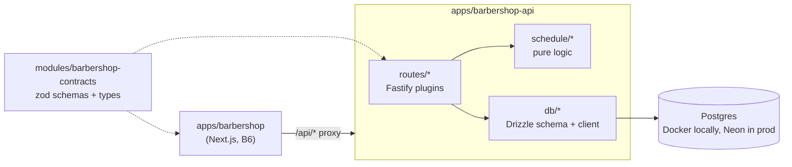
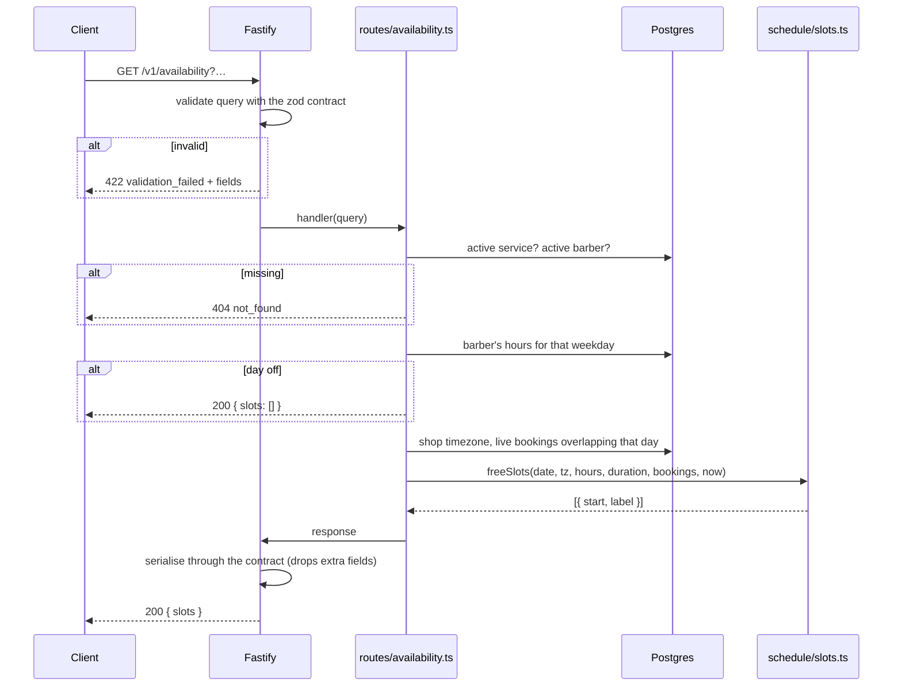

# barbershop-api

The barbershop booking app's backend: a Node + TypeScript HTTP API on Fastify, with Postgres through Drizzle. The full product spec (data model, endpoints, auth, stages) is [`docs/specs/barbershop.md`](../../docs/specs/barbershop.md); this file is how the code works.

## Quick start

Needs Docker Desktop running. From the repo root:

```bash
cp apps/barbershop-api/.env.example apps/barbershop-api/.env
pnpm nx db:up barbershop-api        # Postgres 17 in Docker, host port 5433
pnpm nx db:migrate barbershop-api   # create the tables
pnpm nx db:seed barbershop-api      # the shop, opening hours, demo services and barbers
pnpm nx dev barbershop-api          # http://localhost:3001, restarts on change
```

```bash
curl localhost:3001/health
curl localhost:3001/v1/barbers
```

| Target                       | What it does                                                                    |
| ---------------------------- | ------------------------------------------------------------------------------- |
| `dev` / `start`              | Run the server with `tsx` (`dev` watches files)                                 |
| `test`                       | Vitest: unit tests, plus database tests against `DATABASE_URL`                  |
| `lint` / `typecheck`         | ESLint / `tsc --noEmit`                                                         |
| `db:up` / `db:down`          | Start / stop the Postgres container (data survives in a named volume)           |
| `db:generate` / `db:migrate` | Write a migration from `src/db/schema.ts` / apply pending migrations            |
| `db:seed`                    | Fill the shop and a demo catalogue; safe to re-run (never overwrites catalogue) |

## How it fits together



- **`modules/barbershop-contracts`** is the single definition of every request and response. The API validates with it; the frontend types its client and validates its forms with the same file, so the two can't drift.
- **Routes are thin.** They validate (via the contract), query, call pure functions, and shape the response.
- **`schedule/` is pure**: no database, no clock, no globals. Everything time-related is unit-testable there.
- **The database is the last line of defence.** Checks, foreign keys and the `bookings_no_overlap` exclusion constraint hold even if API code has a bug.

## Folder layout

```
src/
  app.ts            buildApp({ db, now }): the Fastify app, not yet listening
  server.ts         the entry point: env, DB pool, listen on PORT, graceful shutdown
  env.ts            loadEnv() / requireEnv()
  http/errors.ts    the error envelope, error handler, 404 handler, NotFoundError
  routes/           one Fastify plugin per area: health, shop, catalogue, availability
  schedule/         pure time logic: clock helpers, opening-hours check, freeSlots
  db/
    schema.ts       all tables, checks, enums (source for generated migrations)
    tstzrange.ts    custom column type: [start, end) range <-> { start, end }
    client.ts       createDb(url) -> { db, pool }; the Db type
    seed.ts         demo data
  test/             shared test helpers: rolled-back transactions, withApp, fixtures
drizzle/            SQL migrations, committed and reviewed like code
```

## A request, end to end

`GET /v1/availability?serviceId=…&barberId=…&date=2026-12-01`



## Errors

Every error response has one shape:

```json
{
  "error": {
    "code": "validation_failed",
    "message": "Some fields are invalid",
    "fields": { "date": "Invalid ISO date" }
  }
}
```

`code` is stable and meant for code to branch on; `message` is for people and may change. The rules (`src/http/errors.ts`):

| Cause                                          | Status | `code`                                     |
| ---------------------------------------------- | ------ | ------------------------------------------ |
| Request fails its zod schema                   | 422    | `validation_failed`, with `fields`         |
| `throw new NotFoundError()`, or no such route  | 404    | `not_found`                                |
| Fastify's own client errors (bad JSON, 415, …) | as-is  | `bad_request`, `unsupported_media_type`, … |
| Anything else                                  | 500    | `internal` (details only in the log)       |

## Time

Two kinds of time, never mixed:

- **Instants** (`timestamptz`, JS `Date`): bookings and "now".
- **Shop-clock times** (`time`, `"09:30"`): opening hours, barber hours, breaks. Read in `shop_settings.timezone`.

`freeSlots` walks the day in shop-clock minutes and converts to an instant in exactly one place, with `@date-fns/tz`, which applies the UTC offset in force on that date. That's what makes DST days correct. Ranges are half-open `[start, end)`, so back-to-back bookings don't overlap.

## Database workflow

1. Edit `src/db/schema.ts`.
2. `db:generate` writes a new SQL file in `drizzle/`. Read it.
3. `db:migrate` applies it.

Never use `drizzle-kit push`: Drizzle doesn't know about the hand-written `bookings_no_overlap` constraint (`drizzle/0001_…`) and would drop it.

## Tests

- **Unit tests** for pure logic sit next to it (`schedule/*.test.ts`).
- **Database and HTTP tests** run against the real local Postgres. Each runs inside a transaction that is always rolled back (`test/db.ts`), so they leave the seeded dev data untouched. HTTP tests go through `app.inject()` (`test/app.ts`): real routing, validation and serialisation, no open port. They pass a fixed `now`, so time-based rules are repeatable.
- The database must be up and migrated first (`db:up`, `db:migrate`).

## Adding an endpoint

1. Add its request/response schemas to `modules/barbershop-contracts`.
2. Add a route in a plugin under `src/routes/` with `schema: { querystring | body, response }` from the contract, and register it in `app.ts` under `/v1`.
3. Keep logic that doesn't need the database in a pure function, with a unit test.
4. Add an `app.inject()` test for its happy path and its failure statuses.

## Environment

| Name           | Purpose                                       |
| -------------- | --------------------------------------------- |
| `DATABASE_URL` | Postgres connection string                    |
| `PORT`         | Port to listen on; optional, defaults to 3001 |
